# Фронтенд «Курсы и студенты» (лабораторные № 6–7)

Интерфейс на **Vue 3 + Vite**: вход по JWT через FastAPI, список курсов из БД (лаб. № 6) и полный CRUD —
детали, создание, редактирование и удаление курсов — на собственных UI-компонентах (лаб. № 7). Фронтенд запускается **на компьютере** (`npm run dev`), а не в Kubernetes.

| Что | Где |
|-----|-----|
| HTTP-клиент (Axios, JWT, обработка 401) | `src/api/client.js` |
| Состояние входа (Pinia) | `src/stores/auth.js` |
| Маршруты и guard | `src/router/index.js` |
| Экраны | `src/views/LoginView.vue`, `HomeView.vue`, `NotFoundView.vue` |
| Шапка и навигация | `src/App.vue` |
| Тесты (Vitest) | `src/**/__tests__/*.spec.js` |

## Требования

* **Node.js ^22.18 или ≥ 24.12** (этого требует актуальный `create-vue`; Node 18 из методички уже не подходит) и npm ≥ 11.
  С npm 10.9 установка может падать с ошибкой `Cannot read properties of null (reading 'edgesOut')` — обновите npm: `npm install -g npm@11`.
* Запущенный бэкенд из лабораторной № 5 на `http://localhost:8000`.

## 1. Запуск бэкенда

Вариант А — без Docker (SQLite, Redis не обязателен):

```bash
cd ..                                   # корень репозитория
python -m venv .venv && source .venv/bin/activate
pip install -r requirements.txt
export DATABASE_URL=sqlite+aiosqlite:///./app.db
export ADMIN_BOOTSTRAP_USERNAME=admin ADMIN_BOOTSTRAP_PASSWORD=ChangeMe-Admin-2026
uvicorn app.main:app --reload           # http://localhost:8000/docs
python scripts/seed_demo.py             # демо-курсы, student / Student-passw0rd, moder / Moder-passw0rd-1
```

Вариант Б — Docker Compose (PostgreSQL, Redis, RabbitMQ): `docker compose up --build`, затем `python scripts/seed_demo.py`.

CORS: при `ENVIRONMENT=development` (по умолчанию) и незаданной `CORS_ORIGINS` бэкенд разрешает
`http://localhost:5173` и `http://127.0.0.1:5173`. Проверка (шаг 2 методички):

```bash
curl -i -X OPTIONS http://localhost:8000/courses \
  -H "Origin: http://localhost:5173" -H "Access-Control-Request-Method: GET"
# access-control-allow-origin: http://localhost:5173
```

## 2. Запуск фронтенда

```bash
cd frontend-app
npm install
cp .env.example .env.local              # VITE_API_BASE_URL=http://localhost:8000
npm run dev                             # http://localhost:5173
```

Переменные окружения:

| Переменная | Значение по умолчанию | Назначение |
|------------|-----------------------|------------|
| `VITE_API_BASE_URL` | `http://localhost:8000` | адрес FastAPI; префикс `VITE_` обязателен, иначе Vite не передаст её в браузер |

`.env.local` не коммитится (правило `*.local` в `.gitignore`). Порт 5173 закреплён (`strictPort`): если он занят,
Vite не уйдёт молча на 5174, где бэкенд не разрешает CORS.

Учётные записи: `admin / ChangeMe-Admin-2026` (bootstrap-администратор), `student / Student-passw0rd` (создаёт `seed_demo.py`).

## 3. Сквозной сценарий

| Шаг | Ожидаемое поведение | Скриншот |
|-----|---------------------|----------|
| Открыть `http://localhost:5173/` | редирект на `/login` | `docs/screenshots/01-redirect-login.png` |
| Ввести неверный пароль | «Invalid username or password» | `docs/screenshots/02-invalid-password.png` |
| Ввести верный пароль | редирект на `/`, список курсов из БД | `docs/screenshots/03-home-list.png` |
| DevTools → Network | `OPTIONS /courses` 200, `GET /courses` 200 с `Authorization: Bearer …` | `docs/screenshots/04-network.png` |
| Обновить страницу | список остаётся (сессия в httpOnly cookie, профиль из `GET /auth/me`) | — |
| Создать курс в Swagger и обновить | новый курс в списке | `docs/screenshots/05-new-course.png` |
| Нажать Logout | редирект на `/login` | `docs/screenshots/06-logout.png` |

<!-- Вставьте скриншоты после прохождения сценария, например:

-->

Если что-то не работает:

| Симптом | Причина |
|---------|---------|
| «Сервер недоступен или запрос заблокирован (CORS)» при входе | бэкенд не запущен, либо фронтенд открыт не с `http://localhost:5173` (CORS), либо `CORS_ORIGINS=""` |
| В консоли `blocked by CORS policy` | origin фронтенда не в `CORS_ORIGINS`; проверьте порт и `localhost` против `127.0.0.1` |
| Не редиректит на `/login` | сессия ещё жива (cookie) — нажмите «Выйти» в меню пользователя |
| После 30 минут перекидывает на `/login` | истёк access-токен (так задумано: refresh-токен в MVP не используется) |
| «Слишком много попыток входа» | сработал лимит попыток входа бэкенда (лаб. № 5), подождите минуту |

## Лабораторная № 7: компоненты, composables и CRUD

### Структура

```
src/
├── api/
│   ├── client.js          # Axios: JWT в заголовке, 401 → /login (лаб. 6)
│   ├── courses.js         # методы API курсов и toCoursePayload (только поля курса)
│   └── errors.js          # разбор 422 FastAPI/Pydantic v2, понятные сообщения по статусу
├── components/
│   ├── ui/                # «кирпичики» без знаний о предметной области
│   │   ├── BaseButton.vue      # variant primary/secondary/danger, size sm/md/lg, loading, disabled
│   │   ├── BaseInput.vue       # v-model (defineModel), label, hint, error, textarea (multiline)
│   │   ├── BaseModal.vue       # Teleport в body, Transition, Escape, фон, фокус, persistent
│   │   ├── BaseCard.vue        # контейнер; as=li/article, interactive (hover/focus)
│   │   ├── ToastNotification.vue
│   │   └── ToastContainer.vue  # Teleport + TransitionGroup
│   ├── CourseCard.vue     # карточка курса в списке (вся карточка — ссылка)
│   └── CourseForm.vue     # одна форма для создания и редактирования
├── composables/
│   ├── useResource.js     # list/one/create/update/remove + isLoading/error/notFound
│   ├── useForm.js         # значения, валидация, submit, ошибки 422 по полям, isDirty
│   ├── useToast.js        # глобальные уведомления (singleton)
│   └── useDebounce.js     # отложенное значение для поиска
├── views/
│   ├── HomeView.vue           # список + поиск по преподавателю + «+ Добавить»
│   ├── CourseDetailView.vue   # детали, «Редактировать», «Удалить» с подтверждением
│   ├── CourseCreateView.vue   # POST
│   ├── CourseEditView.vue     # PUT, обработка 404
│   ├── LoginView.vue, NotFoundView.vue
└── assets/main.css        # дизайн-токены: --color-*, --radius-*, --shadow-*, --focus-ring
```

| Маршрут | Экран | Доступ |
|---------|-------|--------|
| `/` | список курсов | вход обязателен |
| `/courses/create` | создание | только admin |
| `/courses/:id` | детали | вход обязателен |
| `/courses/:id/edit` | редактирование | только admin |

Статический `/courses/create` объявлен раньше `/courses/:id`, а `:id` дополнительно ограничен цифрами (`:id(\\d+)`).
Роль пользователя берётся из `GET /auth/me`: обычный пользователь не видит кнопок изменения, и guard не пускает его
на create/edit. Настоящую проверку прав выполняет бэкенд (403), интерфейс лишь не предлагает недоступное.

### Что важно в реализации

* **Формы.** `CourseForm` получает `onSubmit` как async-функцию (prop), а не через `emit('submit')`: emit не возвращает
  промис, и ошибка 422 от сервера до формы не дошла бы. Клиент проверяет обязательность, длину и целое число часов,
  верхнюю границу (1000 ч) проверяет только сервер — так видно разбор 422 под полем. В PUT уходят только поля курса:
  `id` из загруженной записи бэкенд отклонил бы как лишнее поле (`extra="forbid"`, лаб. № 5).
* **422.** `useForm` раскладывает `detail[]` FastAPI по полям (`loc[1]`), переводит типовые ошибки Pydantic v2
  (`less_than_equal`, `string_too_long`, `missing`…) на русский, а ошибки по полям, которых нет в форме, показывает общим
  текстом — они не теряются молча.
* **Состояния.** Загрузка, ошибка с кнопкой «Повторить», пустой список, «Ничего не найдено», «Запись не найдена»,
  блокировка кнопок во время запроса и защита от двойной отправки.
* **Удаление** — через модалку подтверждения; пока идёт DELETE, окно не закрывается. В `useResource` удаление
  оптимистичное: запись сразу исчезает из списка и возвращается при ошибке.
* **Поиск** по преподавателю: запрос `GET /courses?instructor=…` уходит через 300 мс после паузы в наборе (debounce),
  ответ на устаревший запрос не перезаписывает более новый.
* **CSS.** Только `<style scoped>` и CSS-переменные из `main.css`; состояния `:hover`, `:focus-visible`, `:disabled`;
  адаптивная сетка `repeat(auto-fill, minmax(240px, 1fr))`: 3 колонки на 1280 px, 1 колонка на 400 px.
* **Доступность.** `label for`, `aria-invalid` и `aria-describedby` у полей, `role="dialog"`, `aria-modal` и фокус в модалке,
  `role="alert"/"status"` у уведомлений, карточка-ссылка доступна с клавиатуры.

### Сквозной CRUD-сценарий (скриншоты из Chrome)

Скриншоты сняты в настоящем браузере (Chrome через Playwright) при работающих `uvicorn` и `npm run dev`.

| Сценарий | Что произошло | Скриншот |
|----------|---------------|----------|
| Открыть `/courses/create` без входа | редирект на `/login?redirect=…` | 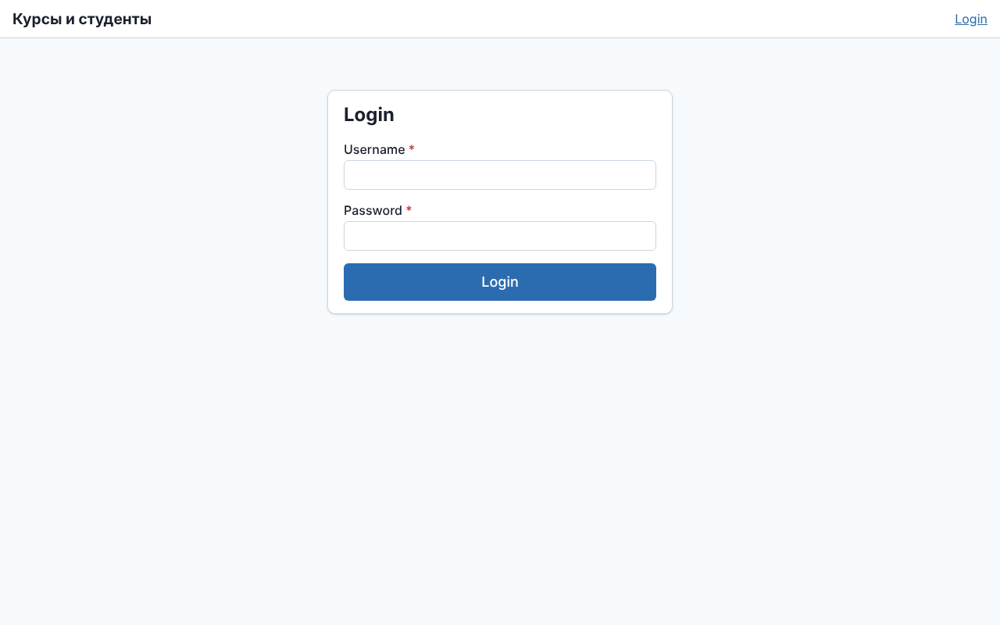 |
| Вход администратором | список курсов, кнопка «+ Добавить» | 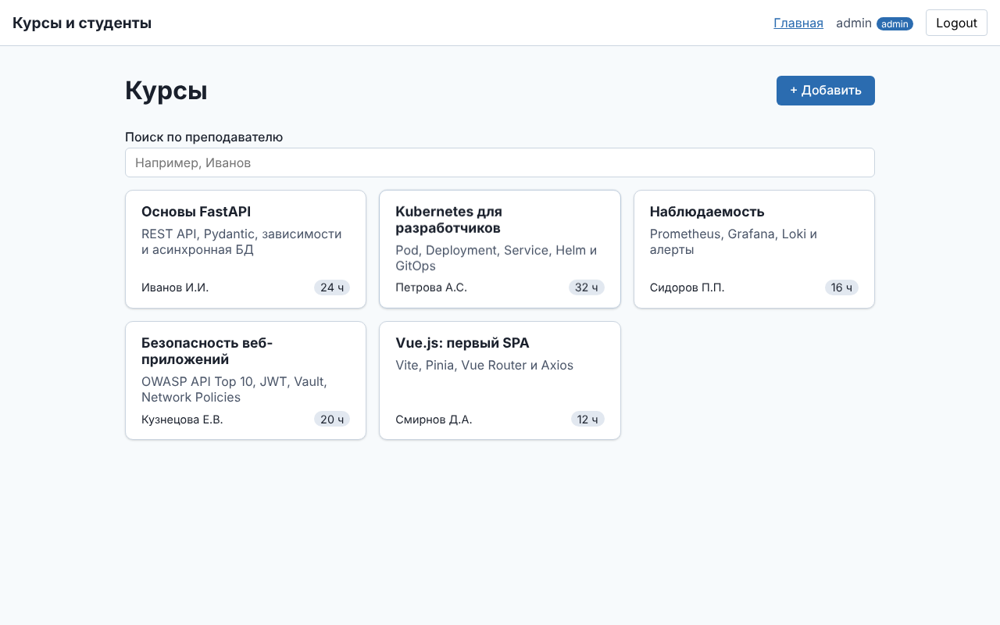 |
| Отправить пустую форму | ошибки под полями, запрос не уходит | 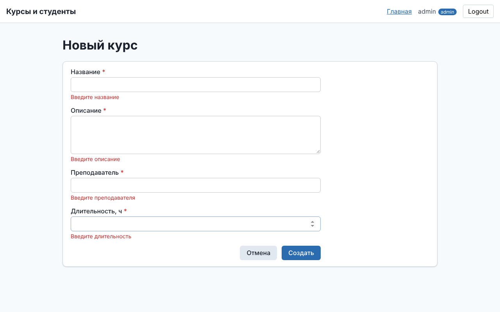 |
| 3000 часов | FastAPI 422 → «Значение должно быть не больше 1000» под полем | 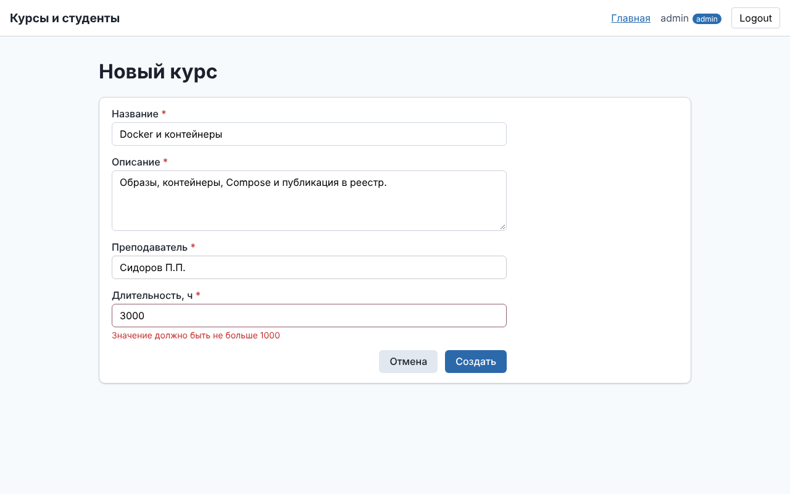 |
| Создать валидный курс | toast «создан», переход на детали | 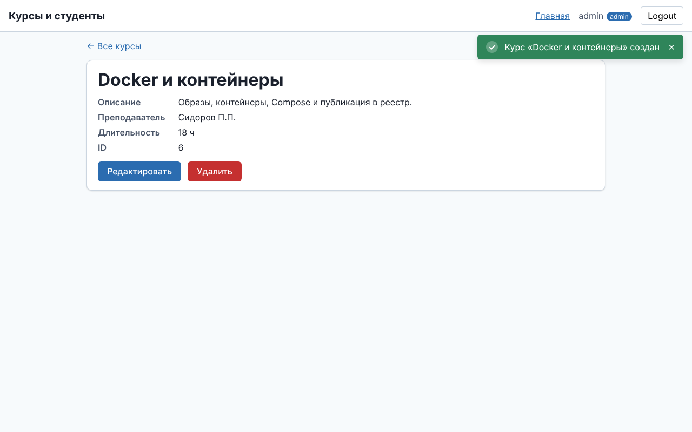 |
| Редактировать | форма заполнена текущими данными | 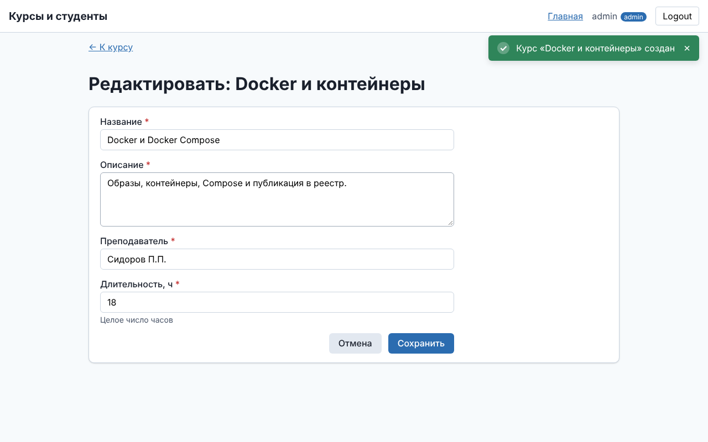 |
| Сохранить | toast «Изменения сохранены» | 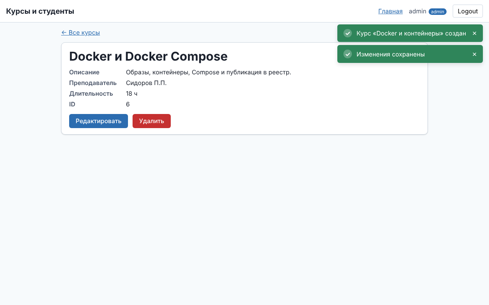 |
| «Удалить» | модалка подтверждения (отмена — курс на месте) | 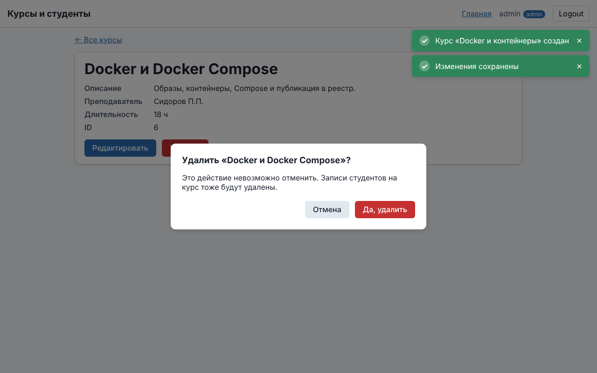 |
| Подтвердить удаление | toast «удалён», переход на список | 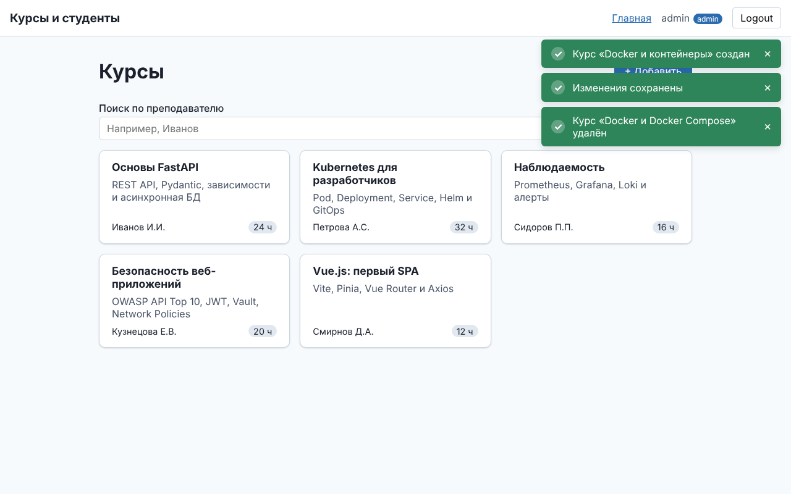 |
| Детали удалённого курса | «Запись не найдена» | 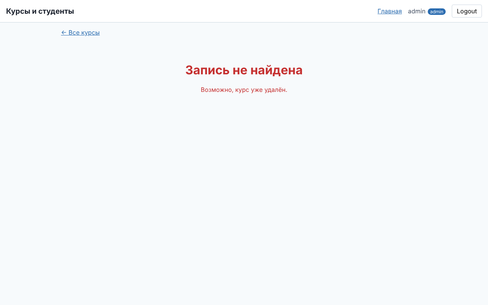 |
| Окно 400 px | карточки в одну колонку | 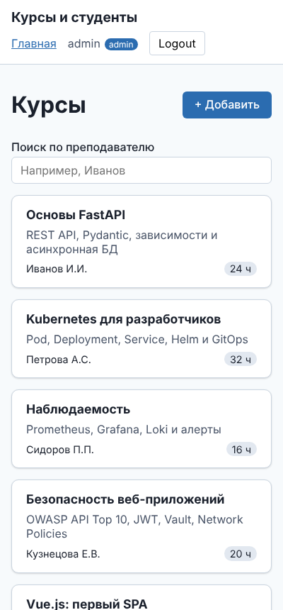 |
| Вход студентом | курс виден, кнопок изменения нет | 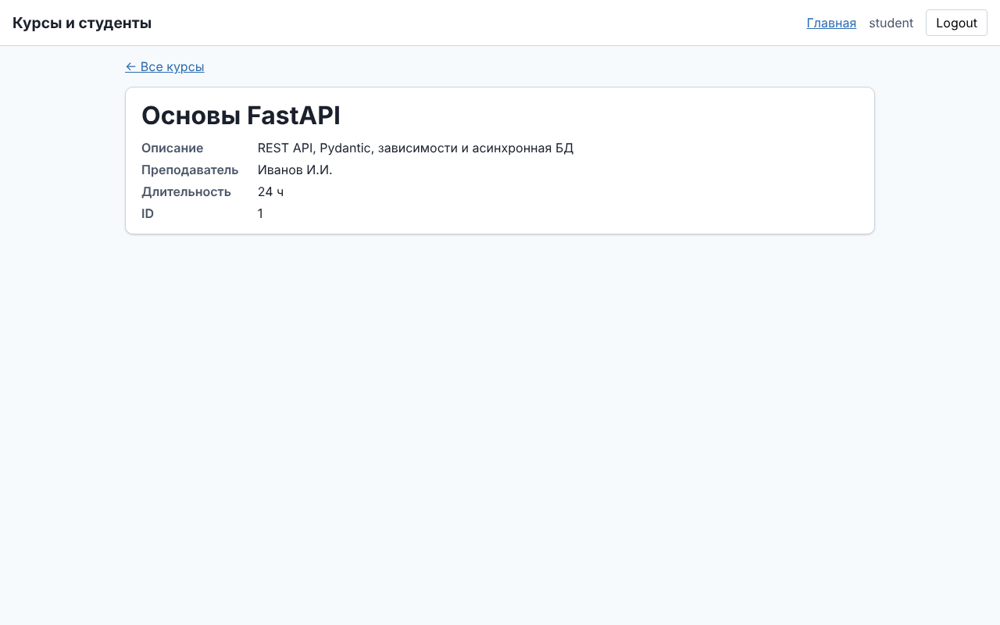 |
| Бэкенд остановлен | «Сервер недоступен…» и «Повторить», а не белый экран | 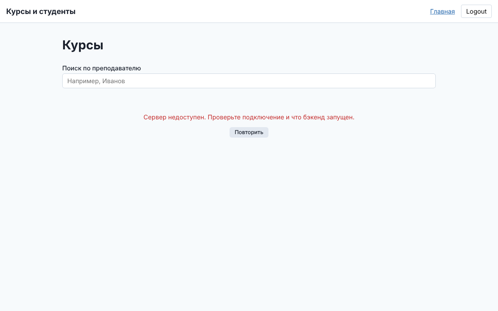 |

Повторить съёмку: запустить бэкенд и `NO_DEVTOOLS=1 npm run dev` (без плавающей панели Vue DevTools).

## Лабораторная № 8: аккаунты, 2FA, сессии и роли

* **Токенов в JS больше нет.** `src/api/client.js` работает с `withCredentials: true`: сессия живёт в httpOnly cookie,
  к изменяющим запросам добавляется `X-CSRF-Token` из cookie `csrf_token`. На 401 выполняется один общий
  `POST /auth/refresh` (single-flight, иначе сработала бы защита reuse detection), затем исходный запрос повторяется.
  Если обновить сессию не удалось, store забывает пользователя и уводит на `/login?redirect=…`.
* `stores/auth.js`: `init()` восстанавливает сессию через `GET /auth/me`, `login()` возвращает `{ twoFactor, tempToken }`,
  `verifyTwoFactor()`, computed `canManageContent` (moderator/admin), `isModerator`, `isAdmin`.
* Маршруты: `/` — `RootView` (гостю `LandingView`, вошедшему `HomeView`), `/register`, `/check-email`, `/verify-email`,
  `/verify-age`, `/account?tab=profile|settings|security|sessions`, `/moderation`. Мета: `requiresAuth`,
  `requiresModerator`, `guestOnly`.
* Аккаунт: `components/account/*` — вкладки и карточки безопасности (`EmailVerificationCard`, `PasswordChangeCard`,
  `TwoFactorCard` с QR и кодами восстановления, `AgeVerificationCard`), `AvatarUpload`, `UserMenu`, `UserAvatar`.
* Кнопки «+ Добавить», «Редактировать», «Удалить» видны только модератору и администратору. Клиент видит плашку
  «Скрыто курсов 18+» и заглушку «Для доступа подтвердите возраст».

Скриншоты сквозного сценария (лендинг → регистрация → письмо в Mailpit → вход → 2FA → сессии → роли):
[`docs/screenshots/lab8/`](../docs/screenshots/lab8/).

## Тесты и проверки

```bash
npm run test:unit          # Vitest в режиме watch
npm run test:run           # однократный прогон (167 тестов)
npm run lint:check         # oxlint + ESLint без автоисправлений
npm run format:check       # Prettier
npm run build              # production-сборка в dist/
```

Тесты лаб. № 7: UI-компоненты (`components/ui/__tests__`), `useForm`, `useResource`, разбор ошибок API, `CourseForm`,
`CourseCard`, экраны деталей, создания и редактирования, маршруты и сквозной CRUD-сценарий (`src/__tests__/app-flow.spec.js`).

«Живые» сквозные тесты против настоящего бэкенда: jsdom работает с origin `http://localhost:5173` и выполняет
CORS-проверки как браузер. Проверяются вход, CRUD (создание с 422, детали, PUT, DELETE, 404) и права студента.

```bash
uvicorn app.main:app --port 8000      # в корне репозитория
python scripts/seed_demo.py
npm run test:live                     # вход, CRUD с 422 и 404, права студента
```
